<div align="center">

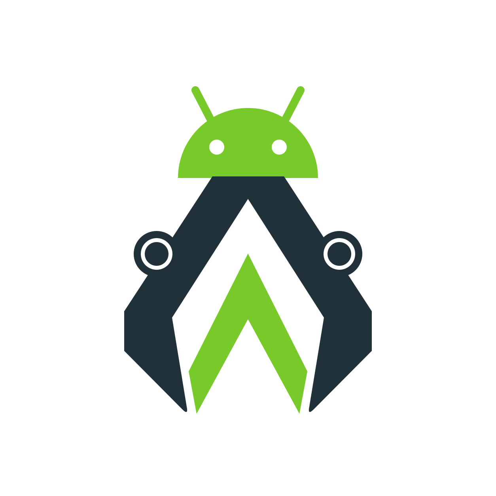

# AndroidClaw

**A small Android-native AI assistant host. One APK, your phone is the host.**

Inspired by NanoClaw and OpenClaw: sessions, typed tools, `SKILL.md` skills and scheduled automations, rebuilt in Kotlin for Android.

[](https://kotlinlang.org/)
[](https://developer.android.com/jetpack/compose)
[](LICENSE)

[Project page](https://androidclaw.top/) · [Latest release](https://github.com/YJLi-new/AndroidClaw/releases/latest) · [CI](https://github.com/YJLi-new/AndroidClaw/actions) · [Changelog](CHANGELOG.md) · [中文说明](#中文说明)

</div>

---

Last verified against repo: 2026-11-01 (v0.3.0)

## What it is

AndroidClaw is a single-APK assistant that runs its whole runtime on the
phone: chat sessions stored in Room, a native tool-calling loop, skills loaded
from `SKILL.md` files, and tasks scheduled with WorkManager and exact alarms.
It talks to a model provider of your choice over HTTPS, or to a built-in
offline demo provider that needs no key and no network.

Version 0.3.0 adds photos in chat, web search, image generation and editing,
video generation, and tap-to-talk voice with read-aloud replies.

It does not embed Node.js, Docker, a browser engine or a shell, and it is not a
remote companion for a desktop gateway.

## Screenshots

| Photo in chat | Generated image | Web search sources | Video | Read aloud |
|:-:|:-:|:-:|:-:|:-:|
| 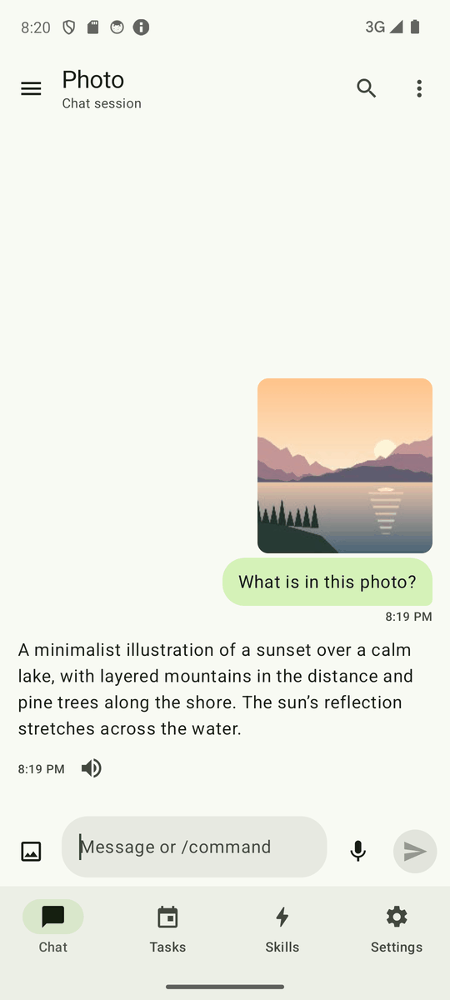 |  | 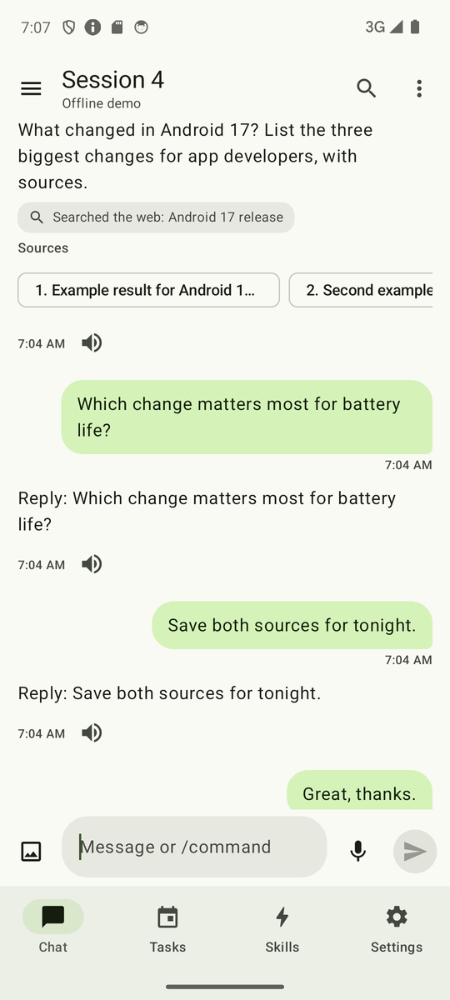 | 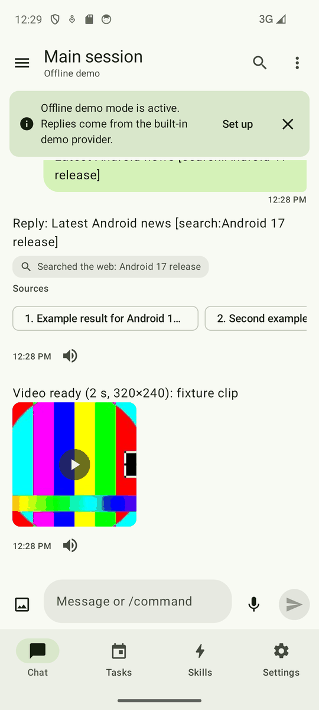 | 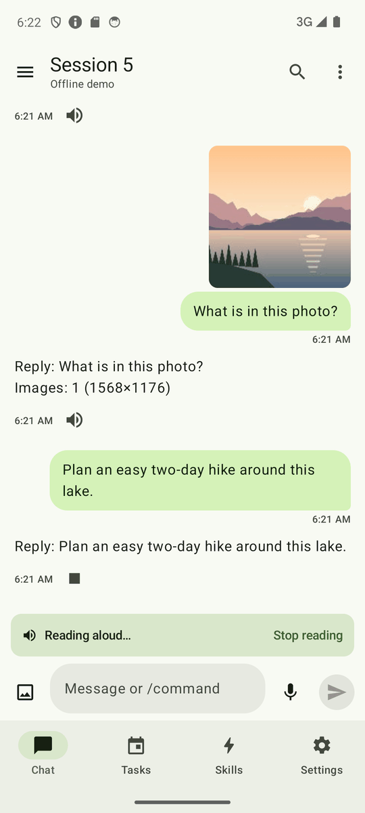 |

| Chat | Tool card | Sessions drawer | Tasks | Task editor |
|:-:|:-:|:-:|:-:|:-:|
| 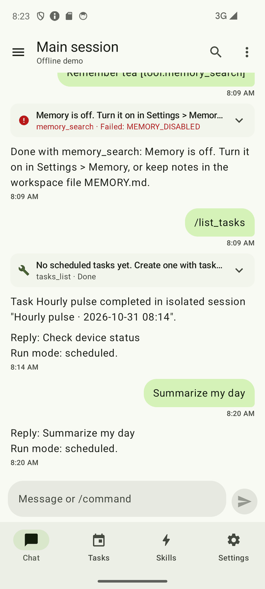 | 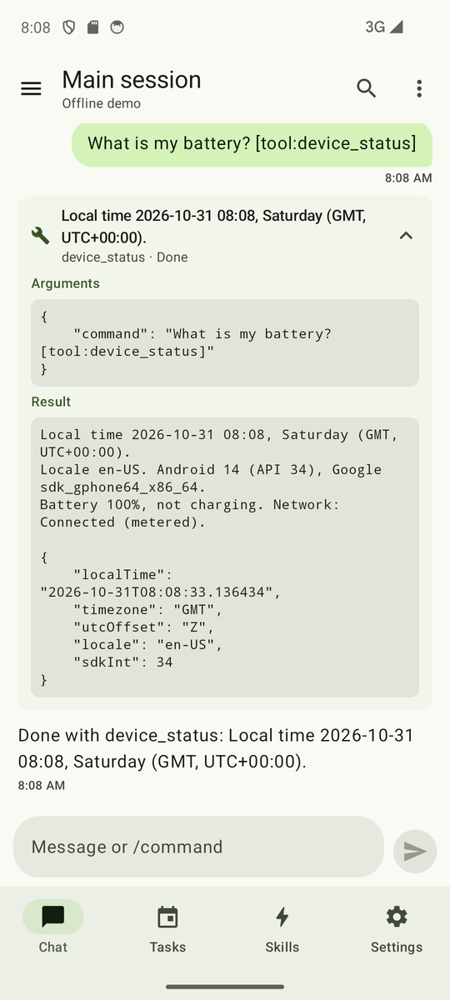 | 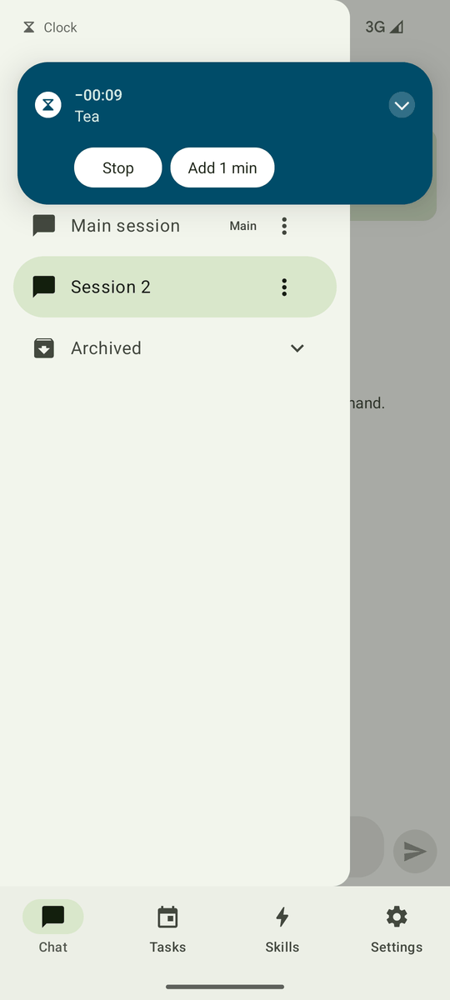 | 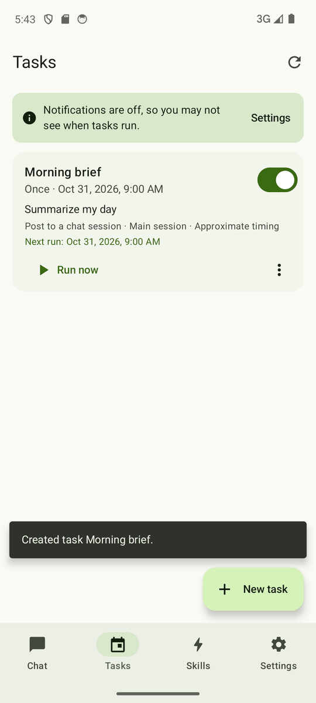 | 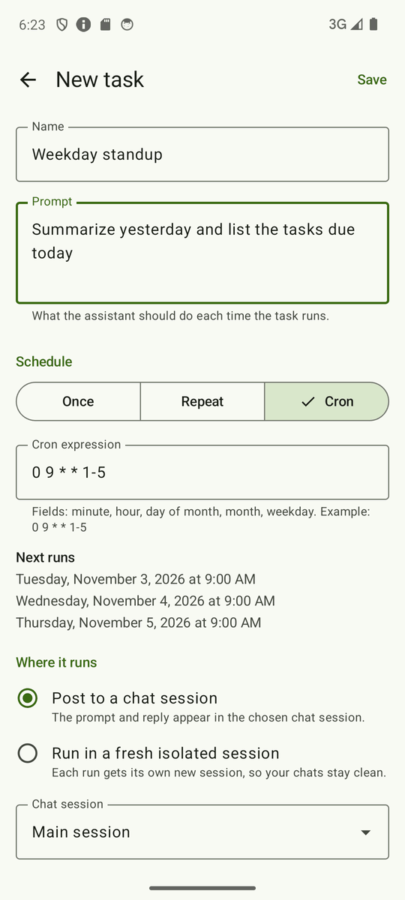 |

| Web search settings | Image, video and voice settings | Skills | Assistant workspace | Diagnostics |
|:-:|:-:|:-:|:-:|:-:|
| 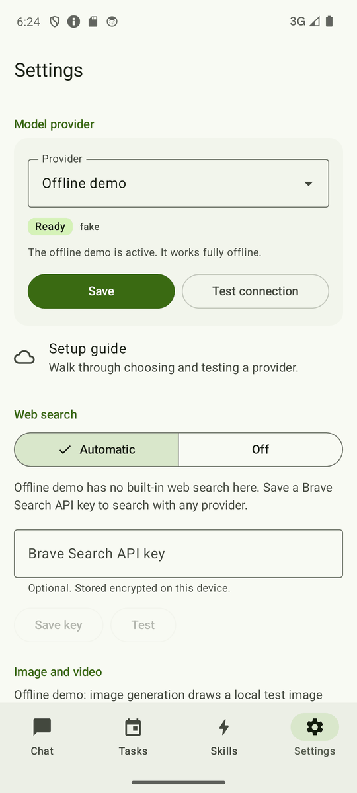 | 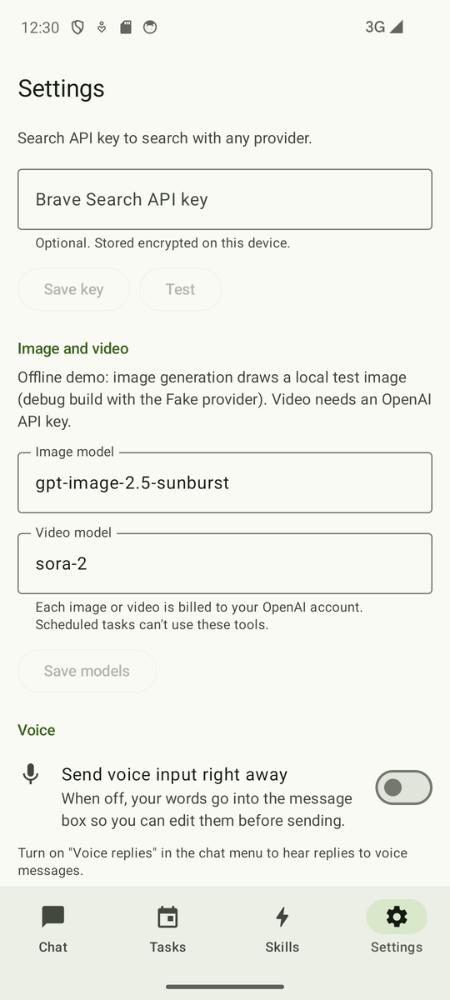 | 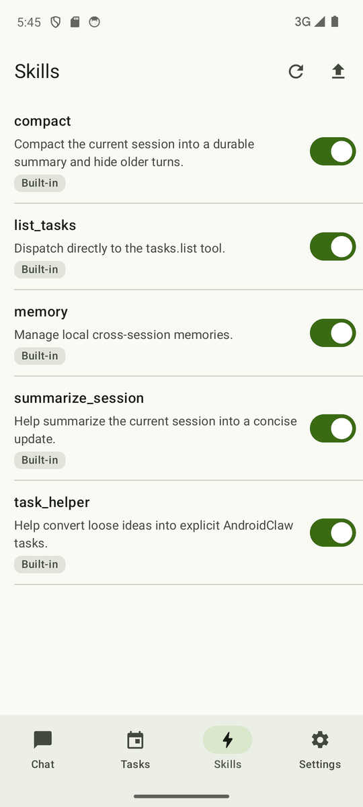 | 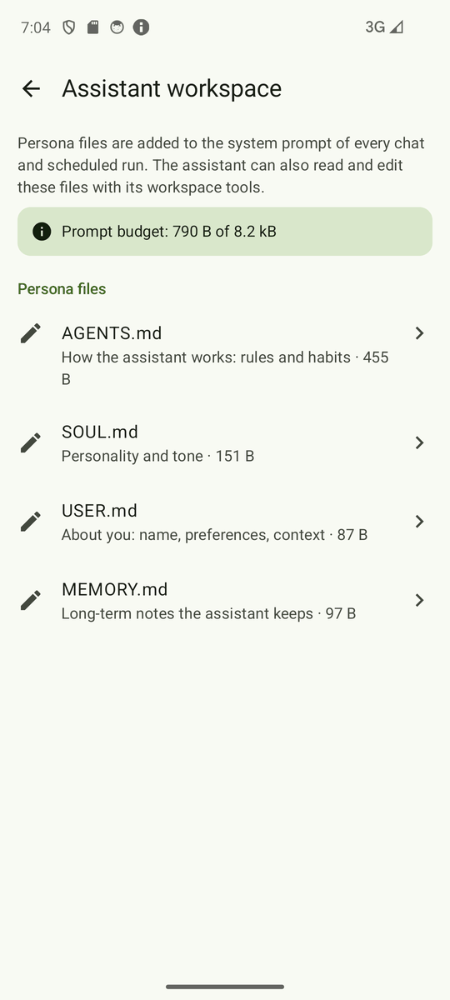 | 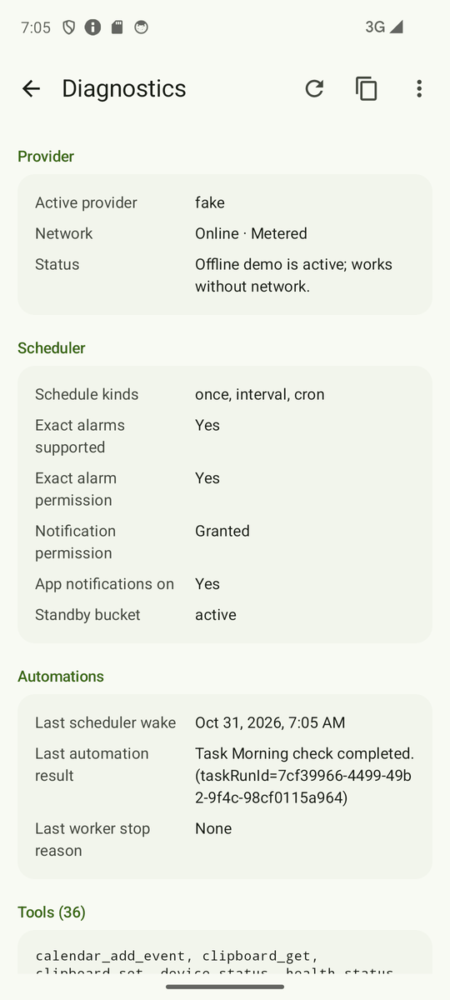 |

| Photo chips | Settings | Onboarding |
|:-:|:-:|:-:|
| 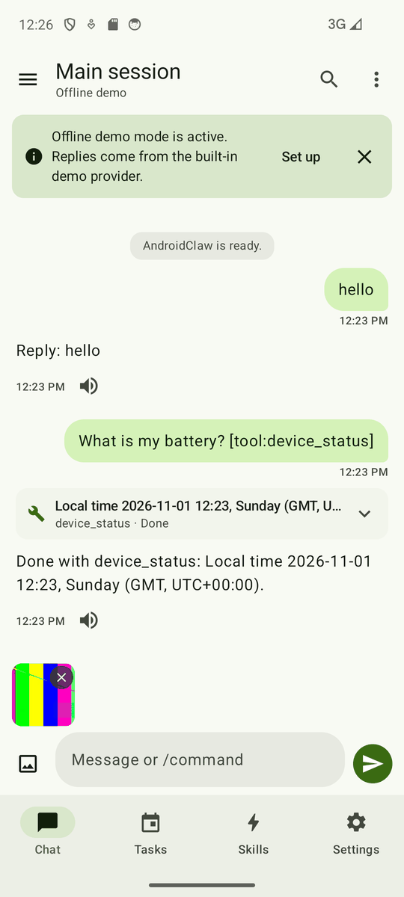 | 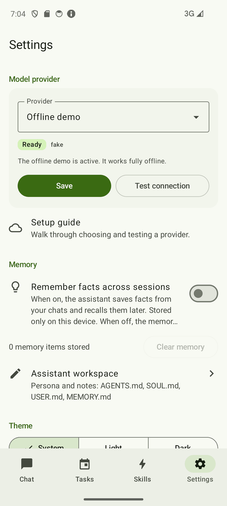 | 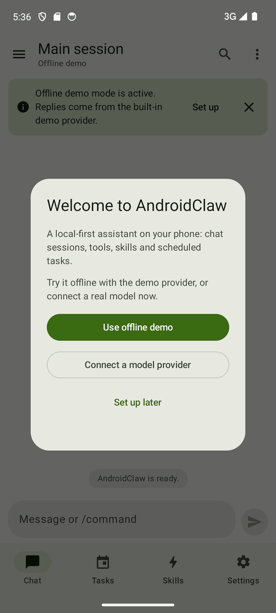 |

## Features

### Chat
- Transcript-first chat screen: top bar with the session title, a modal
  drawer for sessions (new, switch, rename, archive, restore, delete).
- Markdown rendering with code blocks and copy buttons; streaming replies
  with a Stop button.
- Tool calls appear as cards in the transcript: the result summary is the
  title, with the tool name and Done / Failed: CODE / Running below. Expanded
  cards show pretty-printed arguments and result (secret-like fields masked).
  Error codes such as `MEMORY_DISABLED`, `FOREGROUND_REQUIRED` and
  `PERMISSION_REQUIRED` come with a localized hint. Slash commands that
  dispatch straight to a tool show only the card.
- Slash-command suggestions while typing `/`; overflow menu for search,
  share/export, token usage, `/compact` history compaction and Voice replies.
- The main session always exists; scheduled tasks can post into it.

### Photos in chat
- The attach button opens the system photo picker (no storage permission on
  any Android version). Up to 4 images per message, shown as removable chips
  before sending; a message can be images only.
- Images are imported with a sampled decode (never a full-resolution bitmap),
  EXIF orientation applied and metadata dropped, long side at most 1568 px,
  JPEG, at most 1.5 MB each, plus a 256 px thumbnail. They live in app-private
  storage per session and are deleted with their message or session.
- The transcript shows a thumbnail grid. Tap an image for a full-screen
  viewer with Save (Pictures/AndroidClaw) and Share. Chat export lists
  attachments by name.
- Images go to vision models: OpenAI, Codex, Claude and Gemini by default.
  DeepSeek, GLM, Kimi, MiniMax and custom OpenAI-compatible endpoints have a
  "Model accepts images" switch in their provider settings; when it is off,
  the attach button explains why. Only the 2 latest image turns are resent
  (at most 4 images, 8 MB encoded); older images become a text marker.

### Web search
One rule decides how the assistant searches, shown in Settings → Web search
(Automatic / Off):
1. A Brave Search API key is saved → the typed `web_search` tool, for every
   provider and in scheduled runs.
2. No Brave key, and the provider has built-in search (OpenAI Responses,
   OpenAI-compatible on `api.openai.com`, Claude) → the provider's hosted
   search. It works with the model key alone.
3. Otherwise search is off, and Settings says why.

Replies show a "Searched the web: <query>" card and a Sources row (up to 8
links, tap to open in the browser). The Brave key is stored encrypted, and
the Test button checks it.

### Image and video generation
- `image_generate` creates images, or edits photos you attached, through the
  OpenAI Images API. It uses your saved OpenAI API key whatever chat provider
  is active, and is offered only when that key exists. The image appears as a
  tile in the transcript with the same viewer, Save and Share. The model only
  sees `Generated image <id>, <w>×<h>`.
- `video_generate` starts an OpenAI video job and returns at once. A one-shot
  background worker checks the job (it gives up after 30 minutes), downloads
  the mp4 (at most 50 MB), posts it as a message with a poster frame, and
  sends a notification. Tap the tile to play it in the system video player.
- Settings → Image and video holds the model ids (defaults
  `gpt-image-2.5-sunburst` and `sora-2`). Each call is billed to your OpenAI
  account; scheduled tasks cannot use these tools.
- Debug builds with the offline demo provider draw a local test image, so
  image generation works without a key. Video always needs a key.

### Voice
- Tap the mic (shown when the message box is empty and a speech recognizer is
  installed) to dictate through the system recognizer. The recognizer owns
  the microphone, so the app has no `RECORD_AUDIO` permission. The text lands
  in the message box; Settings → Voice → "Send voice input right away"
  (default off) sends it at once.
- Read aloud: a speaker action on every assistant reply, using the platform
  TextToSpeech engine. Markdown is stripped and code blocks are replaced by a
  short phrase. A Stop reading bar stays above the composer while speaking.
- Voice replies (chat menu): replies to messages you dictated are read aloud
  automatically. The mic never reopens by itself.
- Diagnostics → Voice shows the recognizer, the TTS engines and whether TTS
  supports the app language.

### Model-facing tools (37)
Native tool calling only: tool schemas go in the provider's `tools` field and
are not repeated in the system prompt (about 14.6 KB of tool JSON per turn,
unit-tested to stay under 24 KB).

| Group | Tools |
|---|---|
| Sessions | `sessions_list`, `sessions_history`, `sessions_create`, `sessions_rename`, `sessions_send` |
| Memory | `memory_search`, `memory_get`, `memory_remember`, `memory_forget` |
| Tasks | `tasks_list`, `tasks_create`, `tasks_update`, `tasks_delete`, `tasks_run_now`, `tasks_runs` |
| Skills | `skills_list`, `skills_get`, `skills_set_enabled` |
| Workspace files | `workspace_list`, `workspace_read`, `workspace_write`, `workspace_edit` |
| Web | `web_fetch` (public http/https pages as text; private networks blocked), `web_search` (Brave Search; sent only when a Brave key is saved) |
| Media | `image_generate`, `video_generate` (OpenAI; sent only when an OpenAI key is saved) |
| Device and intents | `device_status`, `open_url`, `open_app`, `open_settings`, `set_alarm`, `set_timer`, `calendar_add_event`, `clipboard_get`, `clipboard_set` |
| Notifications and health | `notify`, `health_status` |

- Two more tools are slash-only and never sent to the model:
  `sessions_compact` (`/compact`) and `memory_command` (`/memory`).
- Intent tools (`open_*`, `set_alarm`, `set_timer`, `calendar_add_event`,
  `clipboard_*`) need the app in the foreground. `calendar_add_event` opens a
  prefilled calendar screen and the user saves it.
- Scheduled runs get 19 read-only or opt-in tools (`web_fetch`,
  `web_search`, device status, notify, workspace files, memory
  search/get/remember, session list/history/send, task list/runs, skill
  list/get, health). Foreground-only tools return `FOREGROUND_REQUIRED`
  there, and the paid `image_generate` and `video_generate` are never
  offered.

### Workspace persona files
OpenClaw-style `AGENTS.md`, `SOUL.md`, `USER.md` and `MEMORY.md` live in
app-private storage, are created from templates on first use, and are
injected into the system prompt within an 8 KB budget (truncation is marked).
The assistant can read and edit them with the `workspace_*` tools, and you can
edit them in Settings → Assistant workspace (file list with sizes, prompt
budget meter, monospace editor, reset to template with confirmation,
unsaved-changes guard).

### Skills
- Bundled, local and workspace `SKILL.md` skills with frontmatter parsing,
  precedence, enable/disable (with a confirmation for risky skills), a detail
  screen, and import from a file.
- Bundled skills: `/compact`, `/list_tasks`, `/memory`, `/summarize_session`,
  `/task_helper`. Skills with `command-dispatch: tool` run a tool directly,
  without a model round trip.

### Scheduled tasks
- Once, interval (presets from 15 minutes) and five-field cron schedules,
  edited with local date and time pickers and a next-run preview for cron.
- Post into a chat session or run in a fresh isolated session.
- Edit existing tasks, enable/disable, run now, run history, exact-alarm
  hints when Android denies precise alarms.
- On Android 13+ the notification permission is requested when you save your
  first task (and from the Tasks banner).
- Isolated runs get their own session titled `<task> · <date> <time>`.

### Settings and diagnostics
- Provider setup with a connection test, Web search, Image and video, Voice,
  optional local Memory (with an explanation of what it stores), Assistant
  workspace editor, theme (system/light/dark) and app language
  (system/English/简体中文).
- Diagnostics screen: provider, network, scheduler, notifications, voice,
  recent automation results, exportable report.
- Full English and Simplified Chinese UI (over 500 translated strings and 13
  plurals in each locale, parity enforced by a unit test). Per-app language on
  Android 13+, in-app fallback on Android 8 to 12. Demo-provider replies and
  the tool summaries written for the model stay English in every language (a
  real model answers in yours). The system photo picker and speech recognizer
  follow the system language.

### Providers
| Provider | Transport | Images | Hosted web search |
|---|---|---|---|
| Offline demo (FakeProvider) | Local, deterministic, no key | yes (describes count and size) | scripted with `[search:<query>]` |
| OpenAI | Responses API (`/v1/responses`), default model `gpt-6-luna` | yes | yes |
| OpenAI-compatible | chat/completions; a base URL on `api.openai.com` is routed to the Responses API | switch | only on `api.openai.com` |
| OpenAI Codex | Device-code OAuth sign-in, Responses streaming | yes | no |
| Claude | Native Anthropic Messages API | yes | yes |
| Gemini | OpenAI-compatible preset (chat/completions) | yes | no |
| MiniMax, GLM, Kimi, DeepSeek | OpenAI-compatible presets (chat/completions) | switch | no |

"Switch" means the "Model accepts images" setting, off by default. Without
hosted search, a saved Brave key still gives every provider `web_search`.

All remote providers stream over SSE and keep a non-streaming path for
scheduled runs. API keys, the Brave Search key and Codex OAuth credentials are
stored encrypted on the device.

## Build and test

Requirements: JDK 17, Android SDK with platform 36. `minSdk` is 26.

```bash
export JAVA_HOME=/path/to/jdk17

# The first run must be online: it fills the Gradle cache and verifies
# artifacts against gradle/verification-metadata.xml.
./gradlew :app:assembleDebug
./gradlew :app:testDebugUnitTest
./gradlew :app:lintDebug
./scripts/run_ktlint.sh

# Release-like packaging
./gradlew :app:assembleQa :app:assembleRelease :app:bundleRelease
```

Notes:
- After one online run, `--offline` works.
- If Gradle cannot reach Google Maven but `curl` can, seed the project-local
  fallback repo with `./scripts/seed_android_build_local_maven.sh`.
- `./scripts/run_ktlint.sh` falls back to globs when `git ls-files` fails
  (for example WSL git in a Windows-git worktree) and exits non-zero when it
  finds problems or matches no files.

### Try it without a key
Debug builds start with the offline demo provider. Its replies are
deterministic, and markers in your message script its behavior:

| Send | What happens |
|---|---|
| `What is my battery? [tool:device_status]` | Calls a tool and shows its card |
| `[tool:<name> {json}]` | Calls any tool with JSON arguments |
| `Draw a fox [tool:image_generate]` | Calls `image_generate` with the prompt "Draw a fox"; the debug fake backend draws a test image |
| `Latest Android news [search:Android 17 release]` | Replies like a hosted search: a "Searched the web" card and two example sources |
| A photo from the attach button | Replies with the image count and sizes, e.g. `Images: 1 (1568×1176)` |

Last full run (v0.3.0): unit tests 612 passed of 619, 7 skipped (the live
tests without a key), 0 failed; instrumentation 17/17 on the
`AndroidClawApi34` emulator; lint 0 errors; ktlint 0 findings; `qa`,
`release` APK and bundle build. The QA APK is about 3.2 MB.

### Live provider tests (optional)
`OpenAiLiveTest` (chat, streaming, tool round trip, vision, hosted web search)
and `ImageGenerateLiveTest` call the real OpenAI API and are skipped unless
`ANDROIDCLAW_LIVE_OPENAI_KEY` is set. `ANDROIDCLAW_LIVE_OPENAI_MODEL`
overrides the chat model (default `gpt-6-luna`) and
`ANDROIDCLAW_LIVE_IMAGE_MODEL` the image model. Each run costs real calls.
Read the key from a file into the variable at run time; never commit it.

```bash
ANDROIDCLAW_LIVE_OPENAI_KEY="$(cat /path/to/key.txt)" \
  ./gradlew :app:testDebugUnitTest \
  --tests 'ai.androidclaw.runtime.providers.OpenAiLiveTest' \
  --tests 'ai.androidclaw.runtime.media.ImageGenerateLiveTest'
```

### Device tests (Windows AVD from WSL)

```bash
ANDROIDCLAW_JAVA_HOME=/path/to/jdk17 \
  ./scripts/run_windows_android_test.sh \
  --avd AndroidClawApi34 \
  --test-class ai.androidclaw.app.MainActivitySmokeTest,ai.androidclaw.runtime.scheduler.TaskExecutionWorkerSmokeTest,ai.androidclaw.app.OnboardingProviderSetupSmokeTest,ai.androidclaw.feature.tasks.TasksScreenSmokeTest

ANDROIDCLAW_JAVA_HOME=/path/to/jdk17 \
  ./scripts/run_exact_alarm_regression.sh \
  --api34-avd AndroidClawApi34 \
  --api31-avd AndroidClawApi31
```

## Architecture

One Gradle app module, manual dependency wiring in `AppContainer`, packages:

- `app`: application, activity, container, startup maintenance.
- `ui`: theme, navigation (4 tabs: Chat, Tasks, Skills, Settings), shared
  components, locale handling.
- `feature`: chat (transcript, attachments, sources, voice), tasks, skills,
  settings, diagnostics, onboarding.
- `data`: Room (schema v6, with `message_attachments`), attachment store and
  image import, DataStore settings, encrypted secrets, `WorkspaceStore`.
- `runtime`: agent loop, prompt assembly, providers, tools, web search
  policy, image and video backends with `VideoJobWorker`, speech adapters,
  skills, scheduler, memory.

Stack: Kotlin, Jetpack Compose, Room, WorkManager, coroutines, kotlinx
serialization, OkHttp. No DI framework, no vendor SDKs, no image or media
player library: platform decoding, TextToSpeech, the system recognizer and the
system video player.

## Non-goals

No browser automation, external chat channels (Telegram, WhatsApp, Slack and
so on), X/Twitter integration, remote bridge mode, shell execution, camera
capture, hands-free or continuous voice, voice wake word, or cloud sync.

## License

Apache-2.0. See [LICENSE](LICENSE).

---

## 中文说明

最后核对仓库日期：2026-11-01（v0.3.0）

### 这是什么

AndroidClaw 是一个只有一个 APK 的安卓 AI 助手宿主，整个运行时都在手机上：聊天会话存在 Room 数据库里，模型通过原生工具调用来使用工具，技能来自 `SKILL.md` 文件，定时任务由 WorkManager 和精确闹钟调度。它通过 HTTPS 连接你选择的模型服务，也可以使用内置的离线演示服务（不需要密钥，也不需要联网）。

0.3.0 版新增：聊天中发送照片、联网搜索、图片生成与编辑、视频生成，以及点按说话的语音输入和朗读回复。

它不内嵌 Node.js、Docker、浏览器内核或 shell，也不是桌面网关的远程伴侣应用。

### 截图

| 发送照片 | 生成图片 | 联网搜索来源 | 视频 |
|:-:|:-:|:-:|:-:|
| 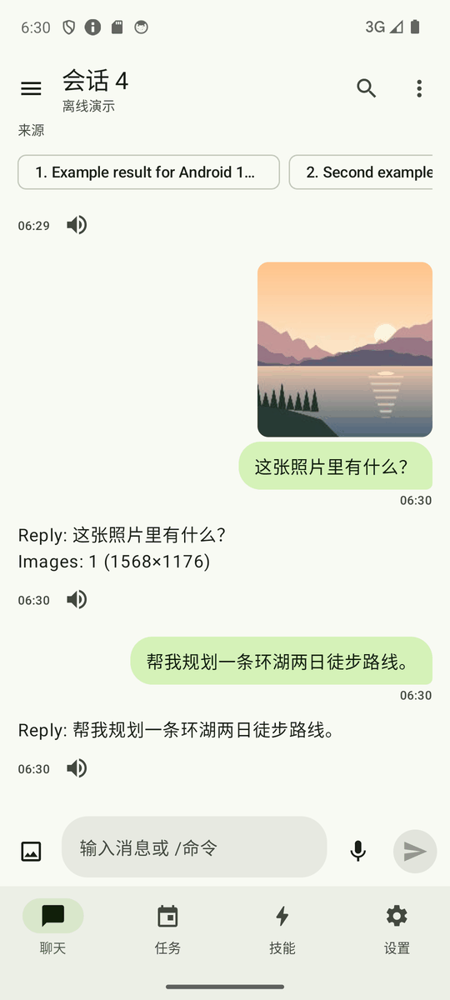 |  | 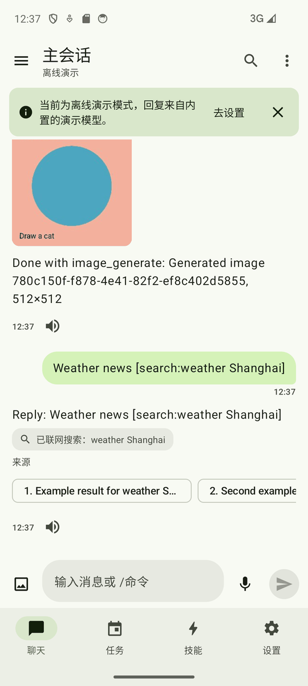 |  |

| 朗读 | 设置：联网搜索 | 设置：图片与视频、语音 | 附加照片 |
|:-:|:-:|:-:|:-:|
| 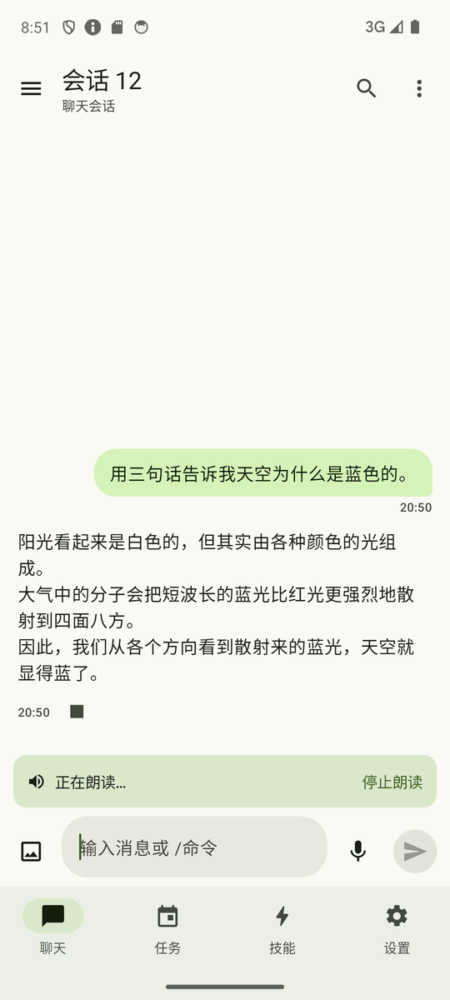 | 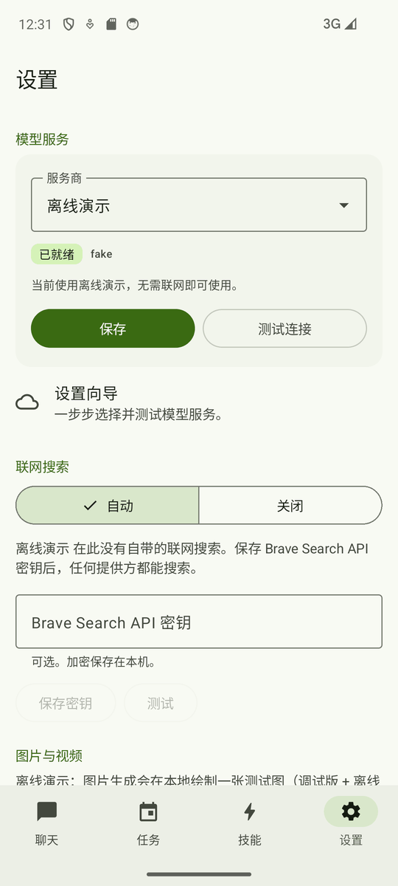 | 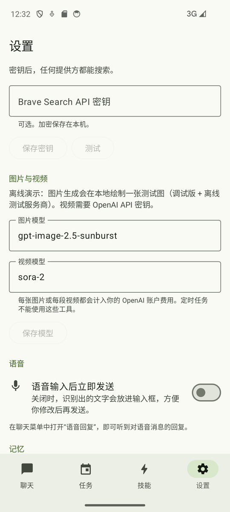 | 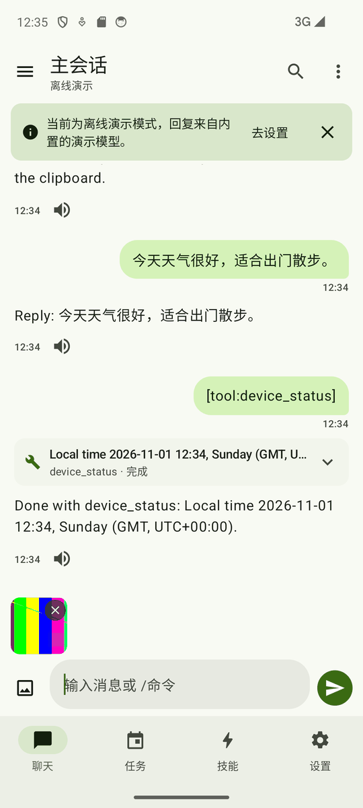 |

| 聊天 | 工具卡片 | 任务 | 任务编辑（Cron） |
|:-:|:-:|:-:|:-:|
| 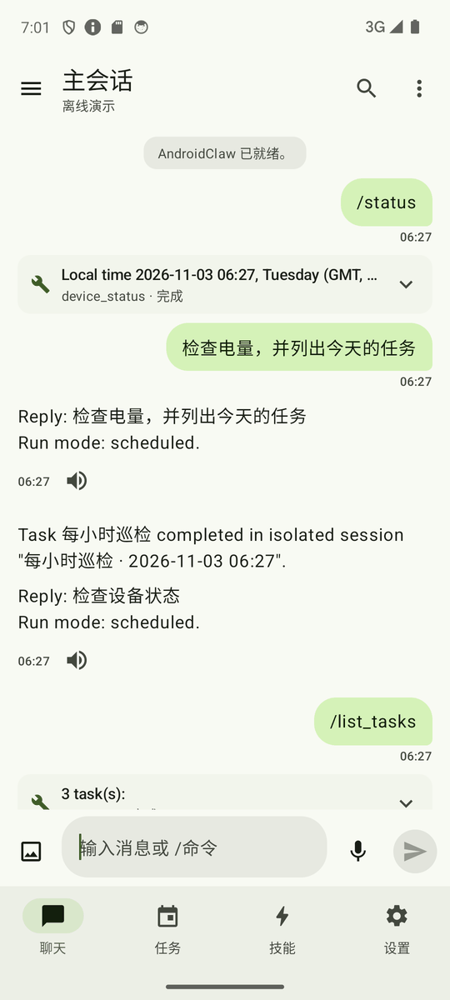 | 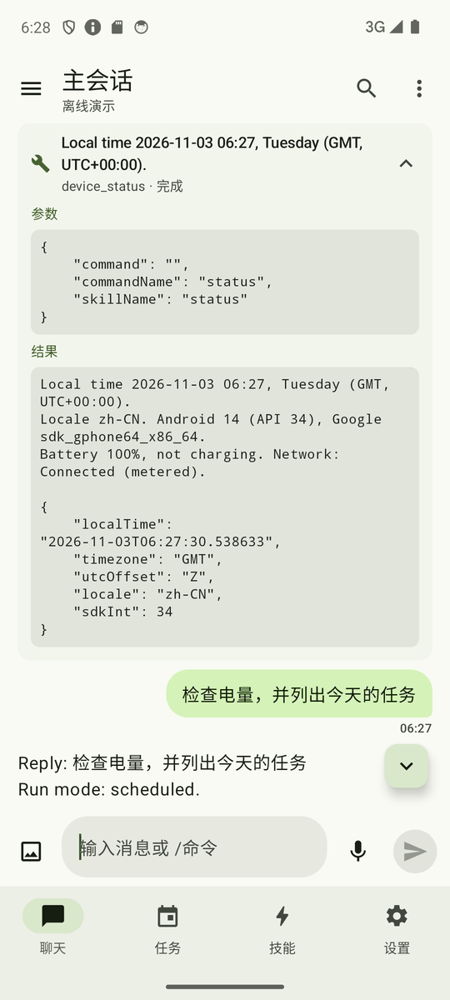 | 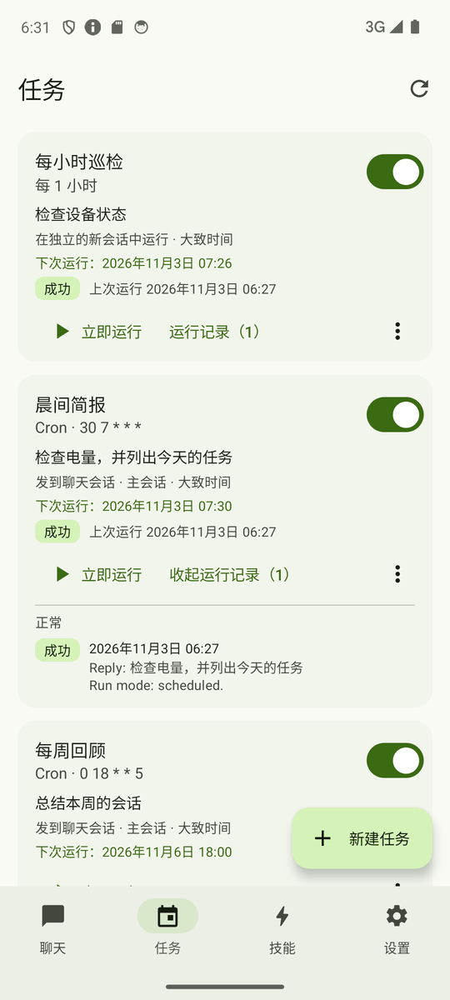 | 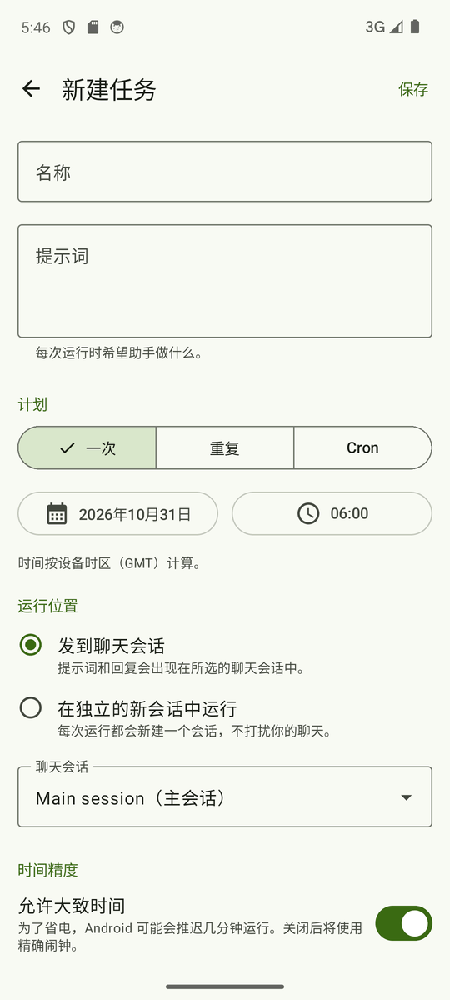 |

| 技能 | 设置 | 助手工作区 | 诊断 |
|:-:|:-:|:-:|:-:|
| 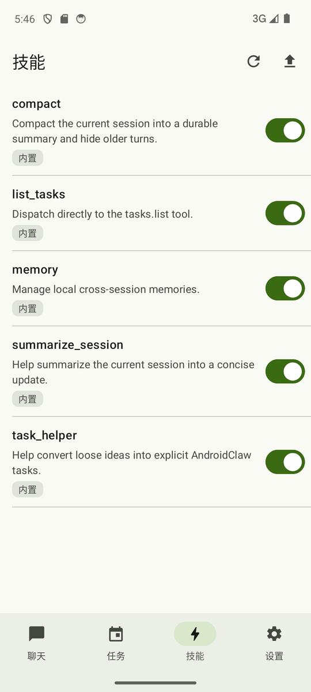 | 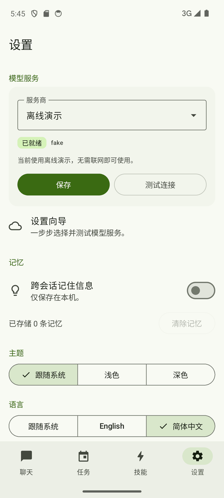 | 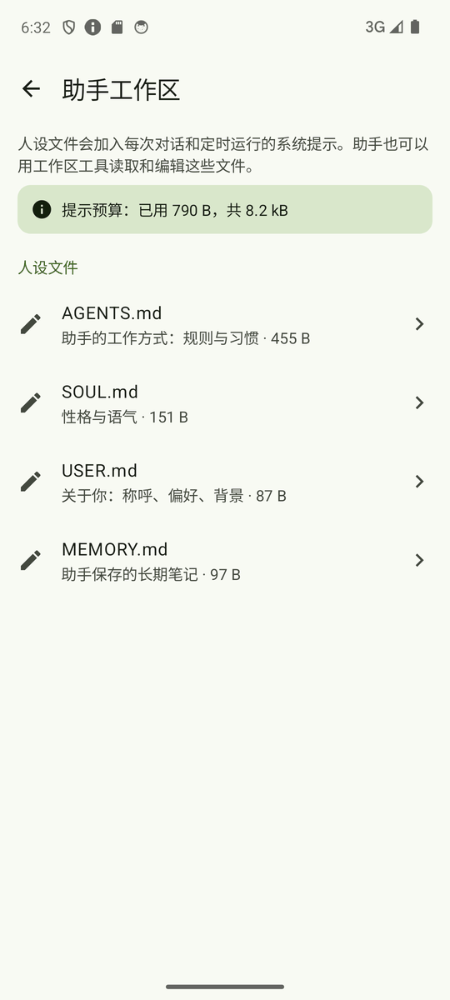 | 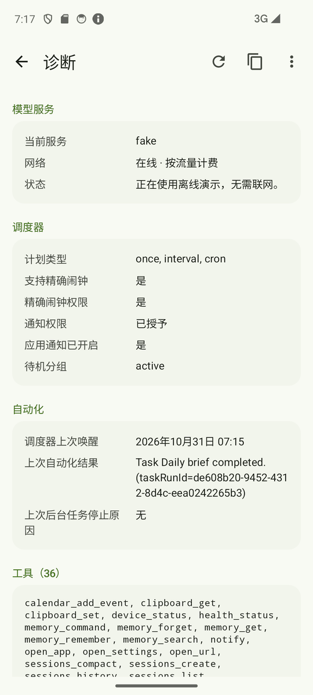 |

### 功能

**聊天**
- 以对话记录为主的聊天界面：顶栏显示会话标题，侧边抽屉管理会话（新建、切换、重命名、归档、恢复、删除）。
- 支持 Markdown 和代码块（可一键复制）；流式输出，可随时停止。
- 工具调用以卡片显示在对话中：标题是结果摘要，下方是工具名和“完成 / 失败：错误码 / 运行中”；展开后显示格式化的参数和结果（疑似密钥的字段会被遮盖）。`MEMORY_DISABLED`、`FOREGROUND_REQUIRED`、`PERMISSION_REQUIRED` 等错误码附带本地化提示。直接调用工具的斜杠命令只显示卡片。
- 输入 `/` 时提示斜杠命令；右上角菜单提供搜索、分享/导出、用量统计、`/compact` 压缩历史和“语音回复”。
- 主会话始终存在，定时任务可以把结果发到主会话。

**在聊天中发送照片**
- 附件按钮打开系统照片选择器（任何 Android 版本都不需要存储权限）。每条消息最多 4 张图片，发送前以可移除的小卡片显示；可以只发图片不写文字。
- 导入时按采样解码（从不在内存中生成全分辨率位图），应用 EXIF 方向并去掉元数据，长边不超过 1568 像素，转为 JPEG，每张不超过 1.5 MB，另存一张 256 像素缩略图。图片按会话存在应用私有目录中，删除消息或会话时一并删除。
- 对话中以缩略图网格显示。点按图片打开全屏查看器，可保存（Pictures/AndroidClaw）和分享。导出聊天时会列出附件名。
- 图片发给支持视觉的模型：OpenAI、Codex、Claude、Gemini 默认开启；DeepSeek、GLM、Kimi、MiniMax 和自定义 OpenAI 兼容服务在服务商设置中有“模型接受图片”开关，关闭时附件按钮会说明原因。只重发最近 2 轮带图片的消息（最多 4 张、编码后 8 MB），更早的图片换成文字标记。

**联网搜索**

由一条规则决定搜索方式，显示在 设置 → 联网搜索（自动 / 关闭）中：
1. 保存了 Brave Search API 密钥 → 使用 `web_search` 工具，所有模型服务和定时任务都能用。
2. 没有 Brave 密钥，但模型服务自带搜索（OpenAI Responses、指向 `api.openai.com` 的 OpenAI 兼容服务、Claude）→ 使用服务商的内置搜索，只需要模型密钥。
3. 其他情况下搜索关闭，设置页会说明原因。

回复下方显示“已联网搜索：<查询>”卡片和来源行（最多 8 个链接，点按在浏览器中打开）。Brave 密钥加密保存，可用“测试”按钮检查。

**图片与视频生成**
- `image_generate` 通过 OpenAI Images API 生成图片，或编辑你附加的照片。无论当前用哪个聊天服务，它都使用已保存的 OpenAI API 密钥，只有存在该密钥时才提供给模型。生成的图片显示在对话中，同样可以查看、保存和分享。模型只看到 `Generated image <id>, <w>×<h>`。
- `video_generate` 发起 OpenAI 视频任务并立即返回。一个一次性的后台任务会检查进度（30 分钟后放弃），下载 mp4（不超过 50 MB），以带封面帧的消息发出并发送通知。点按即可用系统视频播放器播放。
- 设置 → 图片与视频 中可以修改模型（默认 `gpt-image-2.5-sunburst` 和 `sora-2`）。每次调用都会计入你的 OpenAI 账单；定时任务不能使用这两个工具。
- Debug 版本配合离线演示服务时会在本地画一张测试图片，所以不需要密钥也能体验图片生成；视频始终需要密钥。

**语音**
- 消息框为空且系统装有语音识别器时显示麦克风按钮，点按后由系统识别器听写。麦克风由系统识别器控制，所以应用没有 `RECORD_AUDIO` 权限。识别结果填入消息框；设置 → 语音 →“语音输入后立即发送”（默认关闭）可以直接发送。
- 朗读：每条助手回复都有朗读按钮，使用系统 TextToSpeech 引擎。朗读前去掉 Markdown，代码块换成一句简短说明；朗读时输入框上方一直有“停止朗读”。
- 语音回复（聊天菜单）：对你用语音输入的消息，回复会自动朗读。麦克风不会自己再次打开。
- 诊断 → 语音 显示识别器、TTS 引擎，以及 TTS 是否支持应用语言。

**模型可用的工具（37 个）**

只使用原生工具调用：工具定义放在服务商接口的 `tools` 字段里，不在系统提示词中重复列出（每轮约 14.6 KB 工具 JSON，单元测试保证不超过 24 KB）。

| 分组 | 工具 |
|---|---|
| 会话 | `sessions_list`、`sessions_history`、`sessions_create`、`sessions_rename`、`sessions_send` |
| 记忆 | `memory_search`、`memory_get`、`memory_remember`、`memory_forget` |
| 任务 | `tasks_list`、`tasks_create`、`tasks_update`、`tasks_delete`、`tasks_run_now`、`tasks_runs` |
| 技能 | `skills_list`、`skills_get`、`skills_set_enabled` |
| 工作区文件 | `workspace_list`、`workspace_read`、`workspace_write`、`workspace_edit` |
| 网页 | `web_fetch`（把公开的 http/https 网页抓取为文本，禁止访问内网地址）、`web_search`（Brave Search，只有保存了 Brave 密钥时才发给模型） |
| 媒体 | `image_generate`、`video_generate`（OpenAI，只有保存了 OpenAI 密钥时才发给模型） |
| 设备与系统意图 | `device_status`、`open_url`、`open_app`、`open_settings`、`set_alarm`、`set_timer`、`calendar_add_event`、`clipboard_get`、`clipboard_set` |
| 通知与健康 | `notify`、`health_status` |

- 另有两个只能通过斜杠命令使用、不会发给模型的工具：`sessions_compact`（`/compact`）和 `memory_command`（`/memory`）。
- 系统意图类工具（`open_*`、`set_alarm`、`set_timer`、`calendar_add_event`、`clipboard_*`）要求应用在前台。`calendar_add_event` 会打开预填好的日历页面，由用户自己保存。
- 定时任务运行时只能使用 19 个只读或显式开放的工具（`web_fetch`、`web_search`、设备状态、通知、工作区文件、记忆搜索/读取/记住、会话列表/历史/发送、任务列表/运行记录、技能列表/读取、健康状态）；前台专用工具在后台会返回 `FOREGROUND_REQUIRED`，收费的 `image_generate` 和 `video_generate` 永远不会提供给定时任务。

**工作区人设文件**

参照 OpenClaw，`AGENTS.md`、`SOUL.md`、`USER.md`、`MEMORY.md` 保存在应用私有目录中，首次使用时按模板创建，并在 8 KB 预算内注入系统提示词（被截断时会标明）。助手可以用 `workspace_*` 工具读取和修改它们；你也可以在 设置 → 助手工作区 中编辑（文件列表与大小、提示词预算、等宽编辑器、确认后重置为模板、未保存提醒）。

**技能**
- 支持内置、本地和工作区三层 `SKILL.md` 技能：解析 frontmatter、按优先级覆盖、启用/停用（有风险的技能需要确认）、详情页、从文件导入。
- 内置技能：`/compact`、`/list_tasks`、`/memory`、`/summarize_session`、`/task_helper`。声明了 `command-dispatch: tool` 的技能直接调用工具，不经过模型。

**定时任务**
- 支持一次性、按间隔（预设最短 15 分钟）和五段式 cron 计划；使用本地日期、时间选择器，cron 会预览下一次运行时间。
- 结果可以发到某个聊天会话，也可以在新的独立会话中运行。
- 可以编辑已有任务、启用/停用、立即运行、查看运行记录；系统拒绝精确闹钟时会给出提示。
- Android 13 及以上在保存第一个任务时（以及在任务页提示条中）申请通知权限。
- 独立会话运行时会新建标题为 `<任务名> · <日期> <时间>` 的会话。

**设置与诊断**
- 模型服务配置与连接测试、联网搜索、图片与视频、语音、可选的本地记忆（附说明）、助手工作区编辑器、主题（跟随系统/浅色/深色）、应用语言（跟随系统/English/简体中文）。
- 诊断页：模型服务、网络、调度器、通知权限、语音、最近的自动化结果，可导出报告。
- 界面完整支持英文和简体中文（两种语言各有 500 多条翻译字符串和 13 条复数字符串，由单元测试保证一致）。Android 13 及以上使用系统的按应用语言设置，Android 8 到 12 使用应用内切换。离线演示的回复和写给模型的工具摘要在任何语言下都是英文（真实模型会用你的语言回答）。系统照片选择器和语音识别器跟随系统语言。

**模型服务**

| 服务 | 接口 | 图片 | 内置联网搜索 |
|---|---|---|---|
| 离线演示（FakeProvider） | 本地、确定性回复、无需密钥 | 支持（回复图片数量和尺寸） | 用 `[search:<查询>]` 模拟 |
| OpenAI | Responses API（`/v1/responses`），默认模型 `gpt-6-luna` | 支持 | 支持 |
| OpenAI 兼容 | chat/completions；如果 Base URL 指向 `api.openai.com`，会自动改走 Responses API | 开关 | 仅 `api.openai.com` |
| OpenAI Codex | 设备码 OAuth 登录，Responses 流式输出 | 支持 | 不支持 |
| Claude | 原生 Anthropic Messages API | 支持 | 支持 |
| Gemini | OpenAI 兼容预设（chat/completions） | 支持 | 不支持 |
| MiniMax、GLM、Kimi、DeepSeek | OpenAI 兼容预设（chat/completions） | 开关 | 不支持 |

“开关”指“模型接受图片”设置，默认关闭。没有内置搜索的服务，只要保存了 Brave 密钥也能使用 `web_search`。

所有远程服务都支持 SSE 流式输出，定时任务使用非流式路径。API 密钥、Brave Search 密钥和 Codex OAuth 凭据在设备上加密保存。

### 构建与测试

需要 JDK 17 和带 platform 36 的 Android SDK，`minSdk` 为 26。

```bash
export JAVA_HOME=/path/to/jdk17

# 第一次构建必须联网：会下载依赖并按 gradle/verification-metadata.xml 校验。
./gradlew :app:assembleDebug
./gradlew :app:testDebugUnitTest
./gradlew :app:lintDebug
./scripts/run_ktlint.sh

# 发布形态的打包
./gradlew :app:assembleQa :app:assembleRelease :app:bundleRelease
```

说明：
- 联网跑过一次之后可以加 `--offline`。
- 如果 Gradle 访问不了 Google Maven 但 `curl` 可以，用 `./scripts/seed_android_build_local_maven.sh` 填充项目内的备用仓库。
- `./scripts/run_ktlint.sh` 在 `git ls-files` 不可用时（例如在 Windows git 创建的 worktree 中使用 WSL git）会改用文件通配；发现问题或没有匹配到文件时返回非零退出码。

**不用密钥试用**：Debug 版本默认使用离线演示服务，回复是确定的，消息中的标记可以控制它的行为：

| 发送 | 效果 |
|---|---|
| `What is my battery? [tool:device_status]` | 调用工具并显示工具卡片 |
| `[tool:<工具名> {json}]` | 用 JSON 参数调用任意工具 |
| `Draw a fox [tool:image_generate]` | 以 “Draw a fox” 为提示词调用 `image_generate`，Debug 版的模拟后端会画一张测试图片 |
| `Latest Android news [search:Android 17 release]` | 模拟内置搜索：显示“已联网搜索”卡片和两个示例来源 |
| 用附件按钮发送一张照片 | 回复图片数量和尺寸，例如 `Images: 1 (1568×1176)` |

最近一次完整运行（v0.3.0）：单元测试 619 个中 612 个通过、7 个跳过（未提供密钥的真实服务测试）、0 个失败；仪器测试在 `AndroidClawApi34` 模拟器上 17/17 通过；lint 0 错误；ktlint 0 问题；`qa`、`release` APK 和 bundle 均构建成功。QA 版 APK 约 3.2 MB。

**真实服务测试（可选）**：`OpenAiLiveTest`（对话、流式、工具往返、图片理解、内置联网搜索）和 `ImageGenerateLiveTest` 会调用真实的 OpenAI API，只有设置了环境变量 `ANDROIDCLAW_LIVE_OPENAI_KEY` 才会运行；`ANDROIDCLAW_LIVE_OPENAI_MODEL` 指定聊天模型（默认 `gpt-6-luna`），`ANDROIDCLAW_LIVE_IMAGE_MODEL` 指定图片模型。每次运行都会产生真实调用费用。运行时从文件读取密钥到环境变量，不要把密钥提交到仓库。

```bash
ANDROIDCLAW_LIVE_OPENAI_KEY="$(cat /path/to/key.txt)" \
  ./gradlew :app:testDebugUnitTest \
  --tests 'ai.androidclaw.runtime.providers.OpenAiLiveTest' \
  --tests 'ai.androidclaw.runtime.media.ImageGenerateLiveTest'
```

**真机/模拟器测试**：在 WSL 中驱动 Windows 上的 AVD，命令见上文英文部分的 “Device tests”。

### 架构

一个 Gradle 应用模块，在 `AppContainer` 中手动组装依赖：

- `app`：Application、Activity、依赖容器、启动维护。
- `ui`：主题、导航（4 个标签页：聊天、任务、技能、设置）、通用组件、语言切换。
- `feature`：聊天（对话记录、附件、来源、语音）、任务、技能、设置、诊断、首次引导。
- `data`：Room（schema v6，含 `message_attachments` 表）、附件存储与图片导入、DataStore 设置、加密密钥存储、`WorkspaceStore`。
- `runtime`：智能体循环、提示词组装、模型服务、工具、联网搜索规则、图片与视频后端（含 `VideoJobWorker`）、语音适配、技能、调度器、记忆。

技术栈：Kotlin、Jetpack Compose、Room、WorkManager、协程、kotlinx serialization、OkHttp。不使用依赖注入框架，不引入厂商 SDK，也不引入图片或播放器库：使用平台解码、TextToSpeech、系统语音识别器和系统视频播放器。

### 不做的事

不做浏览器自动化、外部聊天渠道（Telegram、WhatsApp、Slack 等）、X/Twitter 集成、远程桥接、shell 执行、相机拍摄、免手动或连续语音对话、语音唤醒和云同步。

### 许可证

Apache-2.0，见 [LICENSE](LICENSE)。
