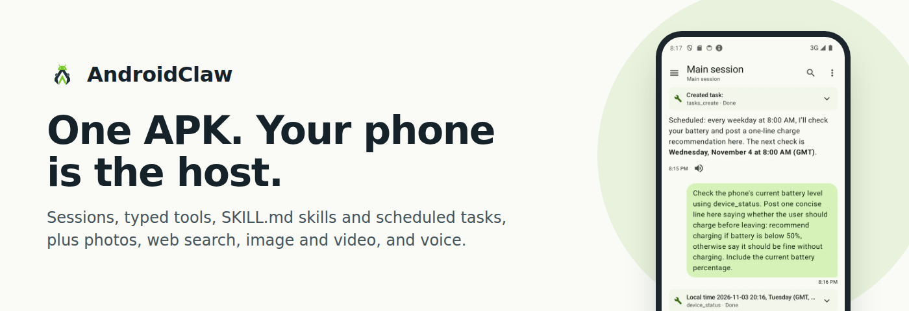

<p align="center"><b>English</b> · <a href="README.zh-CN.md">简体中文</a></p>

<a href="https://androidclaw.top/">
  <picture>
    <source media="(prefers-color-scheme: dark)" srcset="site/assets/readme/banner-en-dark.png">
    
  </picture>
</a>

<p align="center"><b>A small Android-native AI assistant host. One APK, your phone is the host.</b></p>

<p align="center">
  <a href="https://github.com/YJLi-new/AndroidClaw/releases/latest"></a>
  <a href="https://github.com/YJLi-new/AndroidClaw/actions/workflows/android.yml"></a>
  <a href="LICENSE"></a>
  
</p>

<p align="center">
  <a href="https://androidclaw.top/">Website</a> ·
  <a href="https://github.com/YJLi-new/AndroidClaw/releases/latest/download/AndroidClaw-latest.apk">Download APK</a> ·
  <a href="CHANGELOG.md">Changelog</a> ·
  <a href="README.zh-CN.md">中文</a>
</p>

| Chat | Tool card | Photo in chat | Web search | Task editor |
|:-:|:-:|:-:|:-:|:-:|
|  |  |  |  |  |

Android 14 emulator, real replies from OpenAI `gpt-6-luna`.

<details>
<summary>More screenshots</summary>

Some older shots in this list still come from the offline demo.

| Read aloud | Tasks | Skills | Web search settings | Assistant workspace |
|:-:|:-:|:-:|:-:|:-:|
|  |  |  |  |  |

| Generated image | Video | Photo chips | Sessions drawer | Diagnostics |
|:-:|:-:|:-:|:-:|:-:|
|  |  |  |  |  |

| Image, video and voice settings | Settings | Onboarding |
|:-:|:-:|:-:|
|  |  |  |

</details>

Last verified against repo: 2026-11-03 (v0.3.0)

## What it is

AndroidClaw is a single-APK assistant that runs its whole runtime on the
phone: chat sessions stored in Room, a native tool-calling loop, skills loaded
from `SKILL.md` files, and tasks scheduled with WorkManager and exact alarms.
It talks to a model provider of your choice over HTTPS, or to a built-in
offline demo provider that needs no key and no network.

Inspired by NanoClaw and OpenClaw: sessions, typed tools, `SKILL.md` skills
and scheduled automations, rebuilt in Kotlin for Android. It does not embed
Node.js, Docker, a browser engine or a shell, and it is not a remote companion
for a desktop gateway.

## Features

**New in 0.3.0**

- **Photos in chat.** Up to 4 photos per message from the system photo picker, with no storage permission, sent to vision models.
- **Web search.** A saved Brave Search key gives every provider a typed `web_search` tool; otherwise OpenAI and Claude use their hosted search.
- **Image generation and editing.** `image_generate` creates images or edits attached photos through the OpenAI Images API.
- **Video generation.** `video_generate` starts an OpenAI video job; a background worker posts the clip when it is ready.
- **Voice.** Tap-to-talk through the system recognizer, and read aloud on every reply.

**Core**

- **Chat.** Durable sessions with a main session, Markdown, streaming with Stop, and tool calls shown as cards.
- **37 model-facing tools.** Native tool calling for sessions, memory, tasks, skills, workspace files, web, media, device intents and notifications.
- **Skills.** Bundled, local and workspace `SKILL.md` skills with slash commands, enable/disable and import.
- **Scheduled tasks.** Once, interval and cron schedules that post into a chat or run in an isolated session.
- **Workspace persona files.** OpenClaw-style `AGENTS.md`, `SOUL.md`, `USER.md` and `MEMORY.md` in the system prompt.
- **English and 简体中文.** Full UI in both languages, with per-app language on Android 13+.

<details>
<summary>Feature details: chat, photos, web search, image and video, voice</summary>

### Chat
- Transcript-first chat screen: top bar with the session title, a modal
  drawer for sessions (new, switch, rename, archive, restore, delete).
- Markdown rendering with code blocks and copy buttons; streaming replies
  with a Stop button.
- Tool calls appear as cards in the transcript: the result summary is the
  title, with the tool name and Done / Failed: CODE / Running below. Expanded
  cards show pretty-printed arguments and result (secret-like fields masked).
  Error codes such as `MEMORY_DISABLED`, `FOREGROUND_REQUIRED` and
  `PERMISSION_REQUIRED` come with a localized hint. Slash commands that
  dispatch straight to a tool show only the card.
- Slash-command suggestions while typing `/`; overflow menu for search,
  share/export, token usage, `/compact` history compaction and Voice replies.
- The main session always exists; scheduled tasks can post into it.

### Photos in chat
- The attach button opens the system photo picker (no storage permission on
  any Android version). Up to 4 images per message, shown as removable chips
  before sending; a message can be images only.
- Images are imported with a sampled decode (never a full-resolution bitmap),
  EXIF orientation applied and metadata dropped, long side at most 1568 px,
  JPEG, at most 1.5 MB each, plus a 256 px thumbnail. They live in app-private
  storage per session and are deleted with their message or session.
- The transcript shows a thumbnail grid. Tap an image for a full-screen
  viewer with Save (Pictures/AndroidClaw) and Share. Chat export lists
  attachments by name.
- Images go to vision models: OpenAI, Codex, Claude and Gemini by default.
  DeepSeek, GLM, Kimi, MiniMax and custom OpenAI-compatible endpoints have a
  "Model accepts images" switch in their provider settings; when it is off,
  the attach button explains why. Only the 2 latest image turns are resent
  (at most 4 images, 8 MB encoded); older images become a text marker.

### Web search
One rule decides how the assistant searches, shown in Settings → Web search
(Automatic / Off):
1. A Brave Search API key is saved → the typed `web_search` tool, for every
   provider and in scheduled runs.
2. No Brave key, and the provider has built-in search (OpenAI Responses,
   OpenAI-compatible on `api.openai.com`, Claude) → the provider's hosted
   search. It works with the model key alone.
3. Otherwise search is off, and Settings says why.

Replies show a "Searched the web: <query>" card and a Sources row (up to 8
links, tap to open in the browser). The Brave key is stored encrypted, and
the Test button checks it.

### Image and video generation
- `image_generate` creates images, or edits photos you attached, through the
  OpenAI Images API. It uses your saved OpenAI API key whatever chat provider
  is active, and is offered only when that key exists. The image appears as a
  tile in the transcript with the same viewer, Save and Share. The model only
  sees `Generated image <id>, <w>×<h>`.
- `video_generate` starts an OpenAI video job and returns at once. A one-shot
  background worker checks the job (it gives up after 30 minutes), downloads
  the mp4 (at most 50 MB), posts it as a message with a poster frame, and
  sends a notification. Tap the tile to play it in the system video player.
- Settings → Image and video holds the model ids (defaults
  `gpt-image-2.5-sunburst` and `sora-2`). Each call is billed to your OpenAI
  account; scheduled tasks cannot use these tools.
- Debug builds with the offline demo provider draw a local test image, so
  image generation works without a key. Video always needs a key.

### Voice
- Tap the mic (shown when the message box is empty and a speech recognizer is
  installed) to dictate through the system recognizer. The recognizer owns
  the microphone, so the app has no `RECORD_AUDIO` permission. The text lands
  in the message box; Settings → Voice → "Send voice input right away"
  (default off) sends it at once.
- Read aloud: a speaker action on every assistant reply, using the platform
  TextToSpeech engine. Markdown is stripped and code blocks are replaced by a
  short phrase. A Stop reading bar stays above the composer while speaking.
- Voice replies (chat menu): replies to messages you dictated are read aloud
  automatically. The mic never reopens by itself.
- Diagnostics → Voice shows the recognizer, the TTS engines and whether TTS
  supports the app language.

</details>

<details>
<summary>Model-facing tools (37)</summary>

Native tool calling only: tool schemas go in the provider's `tools` field and
are not repeated in the system prompt (about 14.6 KB of tool JSON per turn,
unit-tested to stay under 24 KB).

| Group | Tools |
|---|---|
| Sessions | `sessions_list`, `sessions_history`, `sessions_create`, `sessions_rename`, `sessions_send` |
| Memory | `memory_search`, `memory_get`, `memory_remember`, `memory_forget` |
| Tasks | `tasks_list`, `tasks_create`, `tasks_update`, `tasks_delete`, `tasks_run_now`, `tasks_runs` |
| Skills | `skills_list`, `skills_get`, `skills_set_enabled` |
| Workspace files | `workspace_list`, `workspace_read`, `workspace_write`, `workspace_edit` |
| Web | `web_fetch` (public http/https pages as text; private networks blocked), `web_search` (Brave Search; sent only when a Brave key is saved) |
| Media | `image_generate`, `video_generate` (OpenAI; sent only when an OpenAI key is saved) |
| Device and intents | `device_status`, `open_url`, `open_app`, `open_settings`, `set_alarm`, `set_timer`, `calendar_add_event`, `clipboard_get`, `clipboard_set` |
| Notifications and health | `notify`, `health_status` |

- Two more tools are slash-only and never sent to the model:
  `sessions_compact` (`/compact`) and `memory_command` (`/memory`).
- Intent tools (`open_*`, `set_alarm`, `set_timer`, `calendar_add_event`,
  `clipboard_*`) need the app in the foreground. `calendar_add_event` opens a
  prefilled calendar screen and the user saves it.
- Scheduled runs get 19 read-only or opt-in tools (`web_fetch`,
  `web_search`, device status, notify, workspace files, memory
  search/get/remember, session list/history/send, task list/runs, skill
  list/get, health). Foreground-only tools return `FOREGROUND_REQUIRED`
  there, and the paid `image_generate` and `video_generate` are never
  offered.

</details>

<details>
<summary>Skills, scheduled tasks, workspace, settings and diagnostics</summary>

### Workspace persona files
OpenClaw-style `AGENTS.md`, `SOUL.md`, `USER.md` and `MEMORY.md` live in
app-private storage, are created from templates on first use, and are
injected into the system prompt within an 8 KB budget (truncation is marked).
The assistant can read and edit them with the `workspace_*` tools, and you can
edit them in Settings → Assistant workspace (file list with sizes, prompt
budget meter, monospace editor, reset to template with confirmation,
unsaved-changes guard).

### Skills
- Bundled, local and workspace `SKILL.md` skills with frontmatter parsing,
  precedence, enable/disable (with a confirmation for risky skills), a detail
  screen, and import from a file.
- Bundled skills: `/compact`, `/list_tasks`, `/memory`, `/summarize_session`,
  `/task_helper`. Skills with `command-dispatch: tool` run a tool directly,
  without a model round trip.

### Scheduled tasks
- Once, interval (presets from 15 minutes) and five-field cron schedules,
  edited with local date and time pickers and a next-run preview for cron.
- Post into a chat session or run in a fresh isolated session.
- Edit existing tasks, enable/disable, run now, run history, exact-alarm
  hints when Android denies precise alarms.
- On Android 13+ the notification permission is requested when you save your
  first task (and from the Tasks banner).
- Isolated runs get their own session titled `<task> · <date> <time>`.

### Settings and diagnostics
- Provider setup with a connection test, Web search, Image and video, Voice,
  optional local Memory (with an explanation of what it stores), Assistant
  workspace editor, theme (system/light/dark) and app language
  (system/English/简体中文).
- Diagnostics screen: provider, network, scheduler, notifications, voice,
  recent automation results, exportable report.
- Full English and Simplified Chinese UI (519 translated strings and 13
  plurals in each locale, parity enforced by a unit test). Per-app language on
  Android 13+, in-app fallback on Android 8 to 12. Demo-provider replies and
  the tool summaries written for the model stay English in every language (a
  real model answers in yours). The system photo picker and speech recognizer
  follow the system language.

</details>

## Get started

1. **Install.** [Download the APK](https://github.com/YJLi-new/AndroidClaw/releases/latest/download/AndroidClaw-latest.apk)
   on an Android 8.0+ phone, or pick a version from
   [Releases](https://github.com/YJLi-new/AndroidClaw/releases). Open it and
   allow your browser to install apps if Android asks.
2. **Try the offline demo.** The first screen offers "Use offline demo". The
   demo provider answers on the device with no key and no network.
3. **Add a provider key.** In Settings → Model provider, pick a provider,
   paste the key and run the connection test. Optional: a Brave Search key
   under Web search, and an OpenAI key for image and video generation.

**Supported providers**

| Provider | Transport | Images | Hosted web search |
|---|---|---|---|
| Offline demo (FakeProvider) | Local, deterministic, no key | yes (describes count and size) | scripted with `[search:<query>]` |
| OpenAI | Responses API (`/v1/responses`), default model `gpt-6-luna` | yes | yes |
| OpenAI-compatible | chat/completions; a base URL on `api.openai.com` is routed to the Responses API | switch | only on `api.openai.com` |
| OpenAI Codex | Device-code OAuth sign-in, Responses streaming | yes | no |
| Claude | Native Anthropic Messages API | yes | yes |
| Gemini | OpenAI-compatible preset (chat/completions) | yes | no |
| MiniMax, GLM, Kimi, DeepSeek | OpenAI-compatible presets (chat/completions) | switch | no |

"Switch" means the "Model accepts images" setting, off by default. Without
hosted search, a saved Brave key still gives every provider `web_search`.
All remote providers stream over SSE and keep a non-streaming path for
scheduled runs. API keys, the Brave Search key and Codex OAuth credentials are
stored encrypted on the device.

<details>
<summary>Try it without a key: demo markers (debug builds)</summary>

Debug builds start with the offline demo provider. Its replies are
deterministic, and markers in your message script its behavior:

| Send | What happens |
|---|---|
| `What is my battery? [tool:device_status]` | Calls a tool and shows its card |
| `[tool:<name> {json}]` | Calls any tool with JSON arguments |
| `Draw a fox [tool:image_generate]` | Calls `image_generate` with the prompt "Draw a fox"; the debug fake backend draws a test image |
| `Latest Android news [search:Android 17 release]` | Replies like a hosted search: a "Searched the web" card and two example sources |
| A photo from the attach button | Replies with the image count and sizes, e.g. `Images: 1 (1568×1176)` |

</details>

## Build from source

Requirements: JDK 17, Android SDK with platform 36. `minSdk` is 26.

```bash
export JAVA_HOME=/path/to/jdk17

# The first run must be online: it fills the Gradle cache and verifies
# artifacts against gradle/verification-metadata.xml.
./gradlew :app:assembleDebug
./gradlew :app:testDebugUnitTest
./gradlew :app:lintDebug
./scripts/run_ktlint.sh

# Release-like packaging
./gradlew :app:assembleQa :app:assembleRelease :app:bundleRelease
```

Notes:
- After one online run, `--offline` works.
- If Gradle cannot reach Google Maven but `curl` can, seed the project-local
  fallback repo with `./scripts/seed_android_build_local_maven.sh`.
- `./scripts/run_ktlint.sh` falls back to globs when `git ls-files` fails
  (for example WSL git in a Windows-git worktree) and exits non-zero when it
  finds problems or matches no files.

Last full run (v0.3.0): unit tests 614 passed of 621, 7 skipped (the live
tests without a key), 0 failed; instrumentation 17/17 on the
`AndroidClawApi34` emulator; lint 0 errors; ktlint 0 findings; `qa`,
`release` APK and bundle build. The QA APK is 3,244,963 bytes (about 3.2 MB).

<details>
<summary>Live provider tests and device tests</summary>

### Live provider tests (optional)
`OpenAiLiveTest` (chat, streaming, tool round trip, vision, hosted web search)
and `ImageGenerateLiveTest` call the real OpenAI API and are skipped unless
`ANDROIDCLAW_LIVE_OPENAI_KEY` is set. `ANDROIDCLAW_LIVE_OPENAI_MODEL`
overrides the chat model (default `gpt-6-luna`) and
`ANDROIDCLAW_LIVE_IMAGE_MODEL` the image model. Each run costs real calls.
Read the key from a file into the variable at run time; never commit it.

```bash
ANDROIDCLAW_LIVE_OPENAI_KEY="$(cat /path/to/key.txt)" \
  ./gradlew :app:testDebugUnitTest \
  --tests 'ai.androidclaw.runtime.providers.OpenAiLiveTest' \
  --tests 'ai.androidclaw.runtime.media.ImageGenerateLiveTest'
```

### Device tests (Windows AVD from WSL)

```bash
ANDROIDCLAW_JAVA_HOME=/path/to/jdk17 \
  ./scripts/run_windows_android_test.sh \
  --avd AndroidClawApi34 \
  --test-class ai.androidclaw.app.MainActivitySmokeTest,ai.androidclaw.runtime.scheduler.TaskExecutionWorkerSmokeTest,ai.androidclaw.app.OnboardingProviderSetupSmokeTest,ai.androidclaw.feature.tasks.TasksScreenSmokeTest

ANDROIDCLAW_JAVA_HOME=/path/to/jdk17 \
  ./scripts/run_exact_alarm_regression.sh \
  --api34-avd AndroidClawApi34 \
  --api31-avd AndroidClawApi31
```

</details>

## How it works

Four runtime contracts, matched to OpenClaw's behavior rather than its source:

| Contract | On Android |
|---|---|
| Sessions | Main session plus normal sessions in Room, persistent history, `/compact` summaries |
| Tools | Typed tools with JSON schemas, sent through each provider's native tool calling |
| Skills | `SKILL.md` parsing, frontmatter, enable/disable, import, slash-command dispatch |
| Automations | Once, interval and cron tasks on WorkManager and exact alarms, in the main session or isolated |

One Gradle app module, manual dependency wiring in `AppContainer`, packages:

- `app`: application, activity, container, startup maintenance.
- `ui`: theme, navigation (4 tabs: Chat, Tasks, Skills, Settings), shared
  components, locale handling.
- `feature`: chat (transcript, attachments, sources, voice), tasks, skills,
  settings, diagnostics, onboarding.
- `data`: Room (schema v6, with `message_attachments`), attachment store and
  image import, DataStore settings, encrypted secrets, `WorkspaceStore`.
- `runtime`: agent loop, prompt assembly, providers, tools, web search
  policy, image and video backends with `VideoJobWorker`, speech adapters,
  skills, scheduler, memory.

Stack: Kotlin, Jetpack Compose, Room, WorkManager, coroutines, kotlinx
serialization, OkHttp. No DI framework, no vendor SDKs, no image or media
player library: platform decoding, TextToSpeech, the system recognizer and the
system video player.

## Non-goals

No browser automation, external chat channels (Telegram, WhatsApp, Slack and
so on), X/Twitter integration, remote bridge mode, shell execution, camera
capture, hands-free or continuous voice, voice wake word, or cloud sync.

## Development notes

- Project rules for coding agents live in a local `AGENTS.md` (gitignored):
  hard constraints, architecture taste and validation commands.
- The latest `PLANv*.md` at the repo root is the active plan; older plans
  stay as history. [`CHANGELOG.md`](CHANGELOG.md) lists what each release
  changed.
- `site/` is the website at [androidclaw.top](https://androidclaw.top/),
  deployed by GitHub Pages on every push to `main`. README screenshots and
  banners live in `site/assets/screens/` and `site/assets/readme/`.

## License

Apache-2.0. See [LICENSE](LICENSE).
